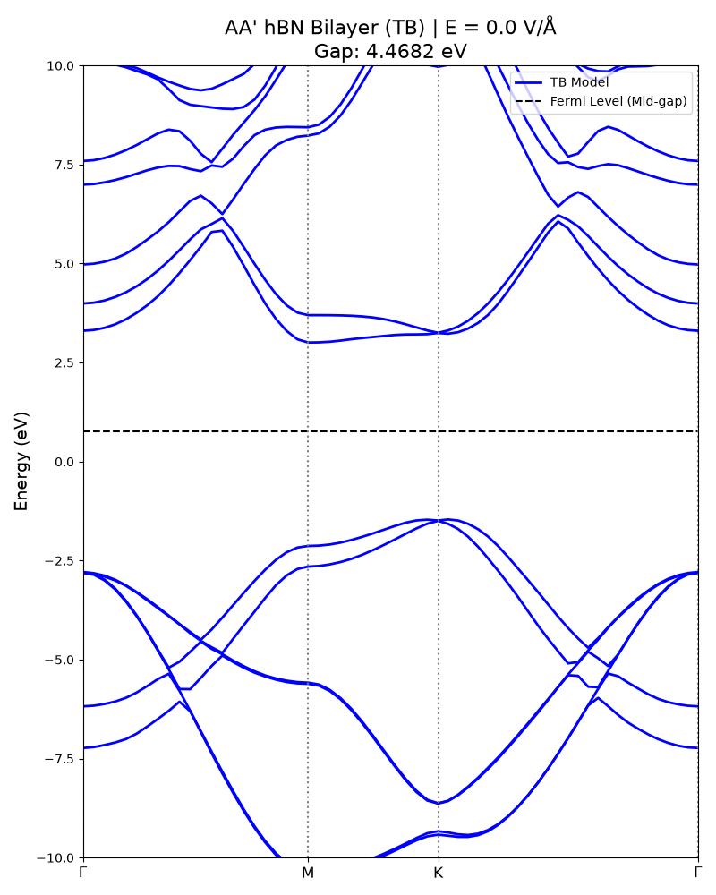
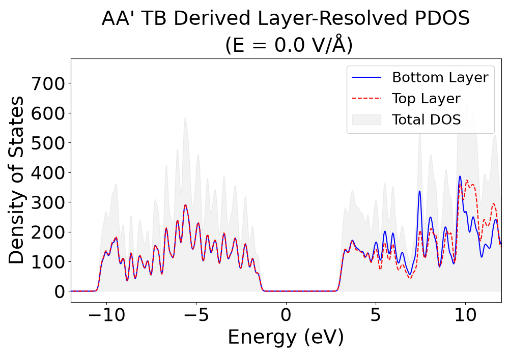

# Tight-Binding Band Structure & Layer-Resolved PDOS for AA' Bilayer hBN

This repository provides a lightweight, standalone Python and Jupyter workflow for computing the **electronic band structure** and **layer-resolved projected density of states (PDOS)** of **AA'-stacked bilayer hexagonal boron nitride (hBN)** under perpendicular electric fields ($E = -1.0$ to $1.0\text{ V/Å}$).

By pre-extracting the tight-binding (TB) hopping parameters from first-principles calculations, the entire pipeline runs using only `numpy`, `scipy`, and `matplotlib`—requiring no heavy DFT or Wannier packages (`GPAW`, `Wannier90`, or `TBmodels`) to reproduce the figures.

---

## Sample Output Figures (E = 0.0 V/Å)

| Reciprocal-Space TB Band Structure | 20×20 Supercell Layer-Resolved PDOS |
| :---: | :---: |
|  |  |

---

## Data Generation & Computational Pipeline

```text
[Stage 1: First-Principles DFT (GPAW)]
   • Relax AA'-stacked bilayer hBN structures under perpendicular electric fields (E = -1.0 to 1.0 V/Å)
   • Compute reference DFT Kohn-Sham band structures along Γ–M–K–Γ and extract global VBM/CBM
                                   │
                                   ▼
[Stage 2: Wannierization & Model Extraction (Wannier90 ──► TBmodels)]
   • Construct maximally localized Wannier functions (16 orbitals per unit cell: 8 Bottom + 8 Top layer)
   • Export raw Wannier90 real-space Hamiltonian (AAprime_hBN_bilayer_E*_hr.dat)
   • Convert via TBmodels (.hdf5) into a reduced Hermitian half-set hopping table (AAprime_TB_Hoppings_E*.txt)
     where H_full = H_half + H_half† and Wigner-Seitz degeneracies are pre-applied
                                   │
                 ┌─────────────────┴─────────────────┐
                 ▼                                   ▼
[Stage 3A: Reciprocal-Space Band Structure]   [Stage 3B: Real-Space Supercell PDOS]
   get_eigenvalues_from_hoppings()               build_supercell_matrix_fixed()
   • Read reduced hoppings (*.txt)               • Tile 20×20 supercell (400 cells, 6400×6400 sparse matrix)
   • Apply Bloch phase exp(i 2π R·k)             • Fold hoppings across boundaries via modulo arithmetic
   • Reconstruct H(k) = H_half(k) + H_half(k)†   • Reconstruct H_super = H_half + H_half† (.tocsr())
   • Diagonalize & align VBM to DFT reference    • Diagonalize & project onto Bottom (0–7) & Top (8–15) orbitals
                 │                                   │
                 └─────────────────┬─────────────────┘
                                   ▼
[Stage 4: Visualization (plotting_bs_dos.ipynb)]
   • Plot TB vs. DFT-aligned band structures and extract E-field-dependent band gaps
   • Plot Gaussian-smeared (σ = 0.1 eV) layer-resolved PDOS showing electrostatic layer splitting
```

---

## Repository Contents

* **`eigenvalue_supercell.py`**: Core computational module containing two functions:
  * `get_eigenvalues_from_hoppings(k_points, hoppings_file, num_orbitals=16)`: Evaluates the $16 \times 16$ Bloch Hamiltonian along a $\mathbf{k}$-path and returns sorted band energies.
  * `build_supercell_matrix_fixed(hoppings_file, nx, ny, num_orbitals=16)`: Constructs a sparse $N_x \times N_y$ real-space supercell Hamiltonian with periodic boundary conditions.
* **`plotting_bs_dos.ipynb`**: Interactive Jupyter Notebook that executes the band structure and $20 \times 20$ supercell layer-resolved PDOS calculations across electric fields ($E = -1.0$ to $1.0\text{ V/Å}$).
* **`AAprime_TB_Hoppings_E*.txt`**: Pre-processed tight-binding hopping tables formatted as `Rx  Ry  Rz  orb_i  orb_j  Re(t)  Im(t)` for 21 electric field values. Stores the reduced Hermitian half-set of hoppings (0-indexed orbitals `0–15`, with onsite terms halved) so the full Hamiltonian is reconstructed via $H_{\mathrm{final}} = H + H^\dagger$.
* **`AAprime_hBN_bilayer_E*_hr.dat`**: Raw Wannier90 real-space Hamiltonian files for all 21 electric field values included for full data provenance.
* **`AAprime_TB_derived_bandstructure_E0.0.png` & `AAprime_PDOS_plot_E_0.0.png`**: Reference output figures at $E = 0.0\text{ V/Å}$.

---

## Theoretical & Numerical Details

### 1. Reduced Hermitian Hopping Convention
Following the internal storage convention of `TBmodels`, the `.txt` hopping files store only one half of each conjugate hopping pair $(\mathbf{R}, i, j) \leftrightarrow (-\mathbf{R}, j, i)$ and half of the diagonal onsite energies ($\mathbf{R} = \mathbf{0}, i = j$). Both functions in `eigenvalue_supercell.py` reconstruct the exact Hermitian operator in a single operation:

$$
H_{\mathrm{final}} = H_{\mathrm{half}} + H_{\mathrm{half}}^\dagger
$$

### 2. Reciprocal-Space Band Structure (`get_eigenvalues_from_hoppings`)
At each fractional wavevector $\mathbf{k}$ along the high-symmetry path $\Gamma \to \mathrm{M} \to \mathrm{K} \to \Gamma$, the half-Hamiltonian is summed using the Convention 2 Bloch phase factor:

$$
H_{\mathrm{half}, ij}(\mathbf{k}) = \sum_{\mathbf{R}} t_{ij}(\mathbf{R}) \, e^{i 2\pi \mathbf{R} \cdot \mathbf{k}}
$$

After enforcing Hermiticity via $H_{\mathrm{final}}(\mathbf{k}) = H_{\mathrm{half}}(\mathbf{k}) + H_{\mathrm{half}}^\dagger(\mathbf{k})$, the eigenvalues are obtained via `numpy.linalg.eigvalsh`. The valence band maximum (Band 7, 0-indexed) and conduction band minimum (Band 8) determine the fundamental gap, and pre-calibrated VBM shifts align the TB spectrum directly to the GPAW DFT reference.

### 3. Supercell Assembly & Layer-Resolved PDOS (`build_supercell_matrix_fixed`)
To evaluate the real-space density of states on an $N_x \times N_y = 20 \times 20$ supercell ($400$ unit cells, $6400$ total orbitals):

1. **Periodic Folding:** Hoppings leaving a unit cell $(i_x, i_y)$ along lattice displacement $(R_x, R_y)$ wrap around the supercell torus via modulo indexing to target cell $(i'_x, i'_y)$:

$$
i'_x = (i_x + R_x) \bmod N_x, \qquad i'_y = (i_y + R_y) \bmod N_y
$$

2. **Layer Projection:** After diagonalizing the $6400 \times 6400$ Hamiltonian, eigenstates $|\psi_n\rangle$ are projected onto the **Bottom Layer** (orbitals `0–7` in each cell) and **Top Layer** (orbitals `8–15` in each cell):

$$
w_{\mathrm{Bottom}, n} = \sum_{c=0}^{N_{\mathrm{cells}}-1} \sum_{\alpha=0}^{7} |\langle c, \alpha | \psi_n \rangle|^2, \qquad w_{\mathrm{Top}, n} = \sum_{c=0}^{N_{\mathrm{cells}}-1} \sum_{\alpha=8}^{15} |\langle c, \alpha | \psi_n \rangle|^2
$$

3. **Gaussian Smearing:** Each discrete eigenvalue $E_n$ is broadened with a Gaussian kernel ($\sigma = 0.1\text{ eV}$) weighted by $w_{\mathrm{Layer}, n}$ to produce smooth layer-resolved PDOS curves:

$$
\mathrm{PDOS}_{\mathrm{Layer}}(E) = \sum_{n} w_{\mathrm{Layer}, n} \frac{1}{\sqrt{2\pi}\sigma} \exp\!\left(-\frac{(E - E_n)^2}{2\sigma^2}\right)
$$

---

## Getting Started

### 1. Clone the Repository & Install Dependencies
```bash
git clone [https://github.com/Jayfjayf/hbn_bilayer_tb_parameter.git](https://github.com/Jayfjayf/hbn_bilayer_tb_parameter.git)
cd hbn_bilayer_tb_parameter
pip install -r requirements.txt
```

### 2. Run the Jupyter Notebook
Launch Jupyter and run `plotting_bs_dos.ipynb` to generate the band structure and layer-resolved PDOS figures:
```bash
jupyter notebook plotting_bs_dos.ipynb
```